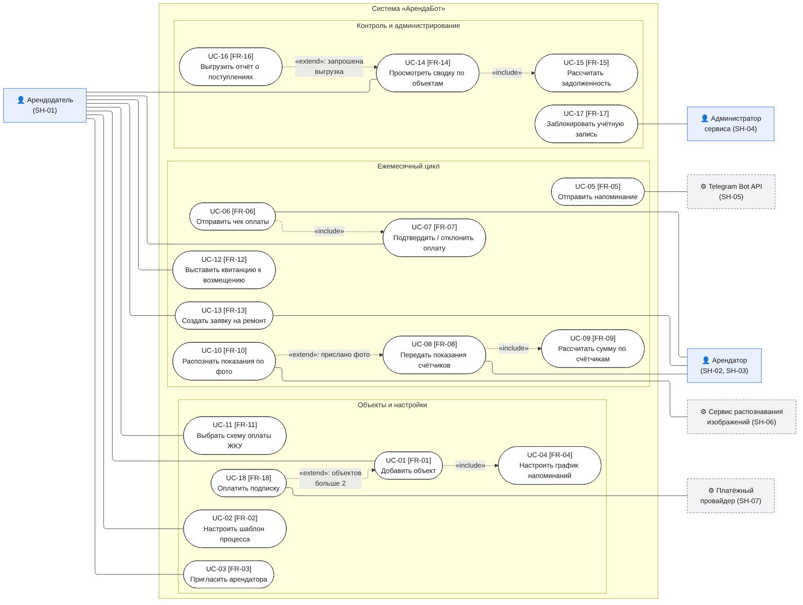

# Лабораторная работа №1. Формулирование требований к программной системе

| Поле | Значение |
|---|---|
| **Студент** | Мильто Семён Евгеньевич |
| **Группа** | РИС-23-1 |
| **Вариант** | Тема ВКР — «Разработка сервиса для управления взаимодействием арендодателя и арендаторов» (Telegram-бот «АрендаБот», рабочее название) |
| **Постановка задачи** | Формулировка, связанная с темой ВКР, — в [readme.md](../../readme.md) |
| **Репозиторий** | <https://github.com/sunr1zy/software-architecture-labs> |
| **Дата сдачи** | 06.12.2026 |

**Тема:** Анализ предметной области и формулирование требований к программной системе.

**Цель работы:** Научиться анализировать поставленную задачу, выделять заинтересованных лиц, формулировать функциональные и нефункциональные требования, представлять результаты в виде диаграммы вариантов использования.

---

## Краткое описание системы

«АрендаБот» — Telegram-бот, автоматизирующий ежемесячное взаимодействие арендодателя с арендаторами жилых и нежилых помещений. Сейчас владелец нескольких объектов вручную, в личных сообщениях, напоминает об оплате аренды, собирает показания счётчиков, считает коммунальные платежи и сверяет чеки — это занимает время и легко что-то упустить. Арендодатель добавляет в боте свои объекты, приглашает на них арендаторов и настраивает под каждый объект свой процесс (график напоминаний, счётчики и тарифы, схему оплаты квитанций); дальше бот сам напоминает арендаторам, принимает чеки и показания (в том числе распознаёт их по фото счётчика), считает суммы и показывает владельцу, кто оплатил, а кто должен.

---

## Оглавление

1. [Стейкхолдеры](#1-перечень-заинтересованных-лиц-стейкхолдеров)
2. [Функциональные требования](#2-перечень-функциональных-требований)
3. [Диаграмма вариантов использования](#3-диаграмма-вариантов-использования)
4. [Нефункциональные требования](#4-перечень-нефункциональных-требований)
5. [Предположения](#5-перечень-сделанных-предположений-повышенная-сложность)
6. [Чек-лист самопроверки](#6-чек-лист-самопроверки)

---

## 1. Перечень заинтересованных лиц (стейкхолдеров)

Выделено 8 стейкхолдеров: 4 внутренних (пользователи и владелец сервиса) и 4 внешних (SH-05…SH-08) — сторонние платформы и организации, от которых система зависит. Арендаторы разделены на физлиц и организации, потому что у жилой и коммерческой аренды разные бизнес-процессы.

| ID | Стейкхолдер | Роль | Интересы / цели | Влияние |
|----|-------------|------|-----------------|---------|
| SH-01 | Арендодатель (владелец квартир или нежилых помещений) | Основной пользователь: добавляет объекты, приглашает арендаторов, настраивает процессы, проверяет оплаты | 1) Перестать вручную напоминать и собирать данные в личной переписке; 2) в любой момент видеть по всем объектам, кто оплатил и кто должен | **высокое** — платит за сервис (подписка), его сценарии определяют весь функционал |
| SH-02 | Арендатор — физическое лицо (жилое помещение) | Получает напоминания, отправляет чеки, показания, заявки на ремонт | 1) Не забывать о сроках и не получать претензий за просрочку; 2) передавать показания и чеки за 1–2 действия, без лишней переписки | **высокое** — пользуется ежемесячно; если ему неудобно, он вернётся к личным сообщениям, и сервис потеряет смысл для владельца |
| SH-03 | Арендатор — организация / ИП (нежилое помещение) | То же, но платит по безналичному расчёту и работает по своему регламенту | 1) Получать суммы к оплате в понятном виде вовремя для своей бухгалтерии; 2) иметь подтверждение переданных показаний | **среднее** — меньшая доля пользователей, но требует отдельного шаблона процесса |
| SH-04 | Администратор сервиса (разработчик) | Поддерживает работу бота, разбирает обращения, блокирует нарушителей | 1) Быстро находить и устранять сбои рассылки; 2) пресекать спам и злоупотребления | **высокое** — принимает решения о развитии, тарифах и правилах сервиса |
| SH-05 | Telegram (Bot API) (внешний) | Платформа, через которую идёт всё взаимодействие | 1) Соблюдение лимитов и правил Bot API (не более ~30 сообщений в секунду на бота, не более 1 в секунду в один чат); 2) отсутствие спама | **высокое** — единственный канал работы; его ограничения напрямую задают архитектуру рассылки |
| SH-06 | Сервис распознавания изображений (OCR / CV-модель) (внешний) | Распознаёт показания по фото счётчика | 1) Получать изображения в поддерживаемом формате и объёме; 2) оплачиваемое количество запросов в пределах тарифа | **среднее** — функция важная (Should), но есть запасной вариант — ручной ввод |
| SH-07 | Платёжный провайдер (Telegram Payments / интернет-эквайринг) (внешний) | Принимает оплату подписки от арендодателей | 1) Корректная передача статусов платежа; 2) выдача чека по 54-ФЗ за подписку на своей стороне | **среднее** — нужен только для монетизации, на основной цикл аренды не влияет |
| SH-08 | Управляющие и ресурсоснабжающие организации (внешний) | Выставляют квитанции ЖКУ и устанавливают тарифы | 1) Получение показаний и оплаты в срок (по договору с собственником) | **низкое** — с системой напрямую не интегрируются, но их квитанции и тарифы — входные данные для FR-09 и FR-12 |

---

## 2. Перечень функциональных требований

Сформулировано 20 требований: 10 Must составляют минимальный ежемесячный цикл «напоминание → оплата / показания → проверка», 6 Should — то, что делает сервис удобнее для владельца нескольких объектов, 2 Could — монетизация и выгрузка для налоговой, 2 Won't — сознательно отложенные интеграции. Приоритет по MoSCoW: Must — без функции бот не заменяет ручную переписку; Should — заметно повышает ценность, но первую версию можно использовать и без неё; Could — при наличии времени; Won't — не в этой версии.

| ID | Требование | Стейкхолдер | Приоритет (MoSCoW) | Обоснование |
|----|------------|-------------|---------------------|-------------|
| FR-01 | Арендодатель может добавить объект аренды, указав тип (жилое / нежилое), название, адрес, ставку аренды, день оплаты и список счётчиков, не более чем за 7 шагов диалога с ботом | SH-01 | Must | Объект — основная сущность, к которой привязано всё остальное |
| FR-02 | Арендодатель может создать шаблон процесса для типа объекта (набор напоминаний, счётчиков, тарифов, схема оплаты ЖКУ) и применять его к новым объектам одной командой | SH-01, SH-03 | Should | Ключевая идея — кастомизация под разные бизнес-процессы (квартиры и коммерческие помещения); шаблон избавляет от повторной настройки каждого объекта |
| FR-03 | Арендодатель может пригласить арендатора на объект по персональной ссылке-приглашению, которая действует 72 часа и может быть использована один раз | SH-01, SH-02, SH-03 | Must | Арендатор попадает в систему без регистрации и ввода данных вручную; одноразовая ссылка не даёт чужим людям подключиться к объекту |
| FR-04 | Арендодатель может настроить для объекта график напоминаний: тип события (аренда, показания, квитанции), день месяца, время и текст; по умолчанию — 1-е, 15-е и 25-е число в 10:00 | SH-01 | Must | Основная ценность сервиса — напоминания; у каждого владельца свои сроки, поэтому график настраивается |
| FR-05 | Система должна отправлять арендатору напоминание по графику объекта и повторять его не более 2 раз с интервалом 24 часа, пока нужное действие (чек, показания) не выполнено | SH-01, SH-02, SH-05 | Must | Заменяет ручные напоминания владельца; ограничение повторов защищает арендатора от спама |
| FR-06 | Арендатор может отправить подтверждение оплаты (аренды или квитанции ЖКУ) — фото или PDF чека размером до 10 МБ с указанием суммы | SH-02, SH-03 | Must | Оплата идёт переводом вне бота (A-03), поэтому чек — единственное подтверждение для владельца |
| FR-07 | Арендодатель может подтвердить или отклонить присланный чек с указанием причины отклонения; арендатор получает результат в течение 1 минуты | SH-01, SH-02 | Must | Владелец остаётся тем, кто признаёт оплату; без подтверждения нельзя корректно считать долги (FR-15) |
| FR-08 | Арендатор может передать показания каждого счётчика объекта, введя число и/или приложив фото; система не принимает показание, меньшее предыдущего | SH-02, SH-03 | Must | Сбор показаний — одна из трёх ежемесячных задач владельца; проверка отсекает очевидные ошибки ввода |
| FR-09 | Система должна рассчитывать расход по каждому счётчику (текущее − предыдущее показание) и сумму по тарифам, заданным арендодателем, и отправлять арендатору и арендодателю итог | SH-01, SH-02, SH-08 | Must | Сейчас владелец считает вручную; автоматический расчёт — прямая экономия времени и меньше споров |
| FR-10 | Система должна распознавать показание по фото счётчика и предлагать арендатору подтвердить или исправить распознанное число; при низкой уверенности распознавания — просить ввести число вручную | SH-02, SH-06 | Should | Упрощает передачу показаний до одной фотографии; Should — ручной ввод (FR-08) остаётся рабочим вариантом |
| FR-11 | Арендодатель может выбрать для объекта схему оплаты ЖКУ: «арендатор оплачивает квитанцию сам и присылает чек» или «арендодатель оплачивает сам, арендатор возмещает» | SH-01 | Must | У разных владельцев разные договорённости; от схемы зависит, кому и какие напоминания приходят |
| FR-12 | Арендодатель может загрузить квитанцию ЖКУ (фото или PDF) с суммой, после чего система выставит арендатору сумму к возмещению с приложенной квитанцией | SH-01, SH-02 | Must | Нужна для схемы «арендатор возмещает» (FR-11): арендатор видит, за что именно платит |
| FR-13 | Арендатор может создать заявку на ремонт с описанием и до 5 фото; арендодатель меняет её статус (Новая → В работе → Выполнена / Отклонена), арендатор получает уведомление о каждом изменении | SH-01, SH-02, SH-03 | Should | Поломки сейчас тоже обсуждаются в личке и теряются; заявка привязана к объекту и имеет историю |
| FR-14 | Арендодатель может открыть сводку по всем объектам за выбранный месяц: по каждому объекту — статус оплаты аренды, передачи показаний и оплаты квитанций | SH-01 | Should | Главная проблема владельца нескольких объектов — нет общей картины; Should — в первой версии статусы видны по каждому объекту отдельно |
| FR-15 | Система должна вести задолженность арендатора по каждому объекту и уведомлять арендодателя о просрочке оплаты более чем на 3 дня (порог настраивается) | SH-01 | Should | Владельцу важнее всего узнать о долге вовремя, а не искать его в переписке |
| FR-16 | Арендодатель может выгрузить отчёт о поступлениях за месяц или год в формате XLSX (объект, арендатор, дата, сумма, назначение) | SH-01 | Could | Удобно для налоговой декларации арендодателя (НДФЛ или НПД), но не влияет на ежемесячный цикл |
| FR-17 | Администратор может заблокировать учётную запись пользователя с указанием причины; заблокированный пользователь получает сообщение о блокировке | SH-04 | Should | Защита от спама и злоупотреблений рассылкой, чтобы бот не был заблокирован Telegram (SH-05) |
| FR-18 | Арендодатель может оплатить подписку через бота, если число его объектов больше 2; после оплаты лимит объектов снимается на оплаченный период | SH-01, SH-07 | Could | Модель монетизации (A-08); на первом этапе сервис можно запускать бесплатно |
| FR-19 | Система должна принимать оплату аренды онлайн через эквайринг и автоматически зачислять её владельцу | SH-01, SH-02 | Won't | Требует, чтобы сервис стал участником расчётов (договор с эквайером, 54-ФЗ, KYC владельцев); в первой версии оплата идёт переводом напрямую (A-03) |
| FR-20 | Система должна автоматически передавать показания счётчиков в управляющую компанию или ГИС ЖКХ | SH-01, SH-08 | Won't | У каждой УК свой способ приёма, единого открытого API нет; откладывается на следующие версии |

---

## 3. Диаграмма вариантов использования

Каждый Use Case соответствует одному требованию FR-01…FR-18; FR-19 и FR-20 (Won't) на диаграмму не вынесены, так как не реализуются. Всего 18 Use Case в трёх группах: «Объекты и настройки», «Ежемесячный цикл», «Контроль и администрирование». Арендатор — один актор для SH-02 и SH-03: варианты использования у них одинаковые, различаются только настройки процесса (FR-02). Внешние системы SH-05…SH-07 показаны справа как вторичные акторы; SH-08 (УК, РСО) на диаграмме нет — интеграции с ними нет (FR-20).

**Связь с требованиями:** ID соответствующего FR указан в названии Use Case (например, `UC-03 [FR-03]`).

**Отношения между UC:**
- `«include»` — UC-01 → UC-04 (при добавлении объекта всегда задаётся график напоминаний, по умолчанию из шаблона); UC-06 → UC-07 (отправленный чек всегда уходит владельцу на подтверждение); UC-08 → UC-09 (переданные показания всегда пересчитываются в сумму); UC-14 → UC-15 (сводка всегда показывает задолженность).
- `«extend»` — UC-10 расширяет UC-08, если арендатор прислал фото счётчика; UC-18 расширяет UC-01, если у арендодателя уже больше 2 объектов; UC-16 расширяет UC-14, если владелец запросил выгрузку.

### Диаграмма

### Описание ключевого сценария

Выбран сценарий передачи показаний счётчиков: он повторяется каждый месяц на каждом объекте, затрагивает обе стороны и внешний сервис распознавания и включает расчёт суммы — то есть это главный источник экономии времени для владельца.

| Поле | Значение |
|---|---|
| **Use Case** | UC-08 [FR-08] Передать показания счётчиков (с расширением UC-10 [FR-10] и включением UC-09 [FR-09]) |
| **Актор** | Основной — арендатор (SH-02 / SH-03); участвуют — арендодатель (SH-01), Telegram Bot API (SH-05), сервис распознавания (SH-06) |
| **Предусловие** | Арендатор привязан к объекту (UC-03); у объекта заданы счётчики и тарифы (UC-01, UC-02); наступила дата напоминания о показаниях (UC-05) |
| **Основной поток** | 1. Бот присылает арендатору напоминание с кнопкой «Передать показания» → 2. Арендатор нажимает кнопку, бот по очереди запрашивает каждый счётчик объекта (например, «Холодная вода») → 3. Арендатор отправляет фото счётчика → 4. Система передаёт фото в сервис распознавания (UC-10) и получает число и уверенность распознавания → 5. Бот показывает распознанное значение с кнопками «Верно» / «Исправить» → 6. Арендатор нажимает «Верно»; система проверяет, что показание не меньше предыдущего → 7. Шаги 2–6 повторяются для остальных счётчиков → 8. Система рассчитывает расход и сумму по тарифам (UC-09) и отправляет итог арендатору и арендодателю |
| **Постусловие** | Показания всех счётчиков за месяц сохранены вместе с фото; рассчитана сумма за коммунальные услуги; статус «Показания» по объекту в сводке (UC-14) — «переданы»; повторные напоминания (FR-05) отменены |
| **Альтернативный поток** | **3a.** Арендатор вводит число вместо фото → распознавание пропускается, сценарий продолжается с шага 6. **4a.** Уверенность распознавания ниже порога или сервис распознавания недоступен → бот просит ввести показание вручную. **5a.** Арендатор нажимает «Исправить» и вводит число вручную. **6a.** Показание меньше предыдущего → бот сообщает об ошибке и просит проверить число; при повторной ошибке показание сохраняется с пометкой «требует проверки», арендодатель получает уведомление |

---

## 4. Перечень нефункциональных требований

Выбраны 5 характеристик, которые прямо вытекают из сути сервиса (по подходу Ричардса и Форда — характеристики, определяющие успех именно этой системы). Сервис ценен только тем, что напоминает вовремя → **надёжность**; все напоминания уходят в одни и те же числа месяца, а Telegram ограничивает скорость отправки → **производительность и масштабируемость рассылки**; бот хранит ФИО, адреса и платёжные чеки → **безопасность**; распознавание фото должно реально экономить время, а не создавать ошибки → **точность распознавания**; арендатор не обязан пользоваться ботом и уйдёт обратно в личку, если неудобно → **удобство использования**. Отброшены: переносимость на другие мессенджеры (только Telegram, A-12), локализация (только РФ, A-01), высокая доступность уровня 99,99 % (кратковременный простой не критичен, если напоминание дойдёт с небольшой задержкой — это покрывает NFR-01), производительность веб-интерфейса (его нет).

| ID | Категория | Требование | Метрика / критерий приёмки | Почему выбрано |
|----|-----------|------------|----------------------------|----------------|
| NFR-01 | Reliability / Availability | Напоминания должны доходить вовремя даже при сбоях, а сам бот — быть доступным | ≥ 99,9 % напоминаний за месяц отправлены не позже 15 мин от запланированного времени; при ошибке Telegram API — повтор до успешной отправки в течение 24 ч, ни одно напоминание не теряется при перезапуске сервиса; доступность бота ≥ 99,5 % в месяц; RPO ≤ 1 ч | Вся ценность сервиса — «бот напомнит сам»; одно пропущенное напоминание о платеже подрывает доверие владельца |
| NFR-02 | Performance / Scalability | Бот должен быстро отвечать на действия пользователей и успевать разослать все напоминания в пиковые дни | Ответ бота на нажатие кнопки или сообщение — ≤ 1,5 с (p95), без учёта распознавания; массовая рассылка 10 000 напоминаний (1-е число, 10:00) — ≤ 10 мин без нарушения лимитов Bot API (~30 сообщений/с); при росте до 10 000 объектов (5× от старта, A-02) p95 ответа растёт не более чем на 20 % | Напоминания концентрируются в 1-е, 15-е и 25-е число в одно и то же время; ограничение Telegram заставляет строить очередь рассылки |
| NFR-03 | Security | Персональные данные и документы пользователей должны быть защищены, а пользователь видеть только свои данные | Соответствие 152-ФЗ: данные хранятся на серверах в РФ, при первом входе запрашивается согласие на обработку ПДн; арендатор имеет доступ только к своим объектам, арендодатель — только к своим (автотесты разграничения доступа — 0 нарушений); чеки и фото хранятся в зашифрованном виде и выдаются только участникам объекта; токен бота и ключи не хранятся в коде; 0 уязвимостей High/Critical по OWASP Top 10 | В боте хранятся ФИО, телефоны, адреса объектов и платёжные чеки — утечка критична для пользователей и юридически наказуема |
| NFR-04 | Accuracy (функциональная пригодность распознавания) | Распознавание показаний по фото должно быть точным и быстрым | ≥ 90 % верно распознанных показаний на тестовой выборке из 200 фото счётчиков (вода, электричество, газ; механические и электронные); время распознавания ≤ 5 с (p95); при уверенности ниже порога система не подставляет число, а просит ручной ввод (0 случаев автоматического сохранения без подтверждения арендатора) | Ошибка распознавания = неверная сумма к оплате и спор между сторонами; функция полезна только если ей можно доверять |
| NFR-05 | Usability | Арендатор должен пользоваться ботом без инструкций | Новый арендатор от перехода по ссылке-приглашению до передачи первых показаний — ≤ 3 мин без помощи владельца (проверка на 5 тестовых пользователях); любое регулярное действие (чек, показания одного счётчика) — не более 3 нажатий или сообщений; все действия доступны через кнопки, без ввода команд | Арендатор — не заказчик сервиса и ничем не мотивирован; если боту неудобно пользоваться, он вернётся к личной переписке, и владелец не получит выгоды |

---

## 5. Перечень сделанных предположений (повышенная сложность)

В теме ВКР не зафиксированы масштаб, юридические рамки, способ оплаты и монетизация. Ниже — решения, которые приняты при формулировании требований.

| ID | Предположение | Влияние на требования |
|----|---------------|-----------------------|
| A-01 | Сервис работает в РФ, интерфейс на русском языке, суммы в рублях | Нет требований к локализации и мультивалютности; обязательно соответствие 152-ФЗ (NFR-03) |
| A-02 | Целевая аудитория — частные арендодатели с 1–20 объектами. На старте ≈ 500 арендодателей, 2 000 объектов, 3 000 арендаторов; рост до 10 000 объектов за 2 года | Задаёт объём рассылки и рост для NFR-02 |
| A-03 | Деньги проходят мимо сервиса: арендатор переводит аренду и коммунальные платежи напрямую владельцу (на карту, по СБП), в бот присылает только чек | Сервис не является участником расчётов — не нужен 54-ФЗ для аренды и PCI DSS; онлайн-оплата аренды отложена (FR-19 — Won't); подтверждение оплаты — ручное (FR-07) |
| A-04 | Пользователь идентифицируется по аккаунту Telegram, без логинов и паролей; роль (арендодатель / арендатор) определяется действиями: создал объект или перешёл по приглашению | Нет отдельных требований к регистрации и восстановлению пароля; приглашение по ссылке (FR-03) — единственный способ стать арендатором объекта |
| A-05 | Часовой пояс задаётся для каждого объекта; напоминания приходят по местному времени объекта; по умолчанию: аренда — 1-е число, показания — 15-е, квитанции — 25-е, в 10:00 | Значения по умолчанию в FR-04; пиковая нагрузка в эти дни (NFR-02) |
| A-06 | Тарифы ЖКУ арендодатель вводит и обновляет вручную; интеграции с УК, РСО и ГИС ЖКХ нет | FR-09 считает по тарифам владельца; FR-20 — Won't |
| A-07 | Распознавание выполняется внешним OCR/CV-сервисом или собственной моделью; поддерживаются счётчики воды, электроэнергии и газа с цифровым табло; фото до 10 МБ | Задаёт границы FR-10 и тестовую выборку NFR-04; внешний стейкхолдер SH-06 |
| A-08 | Монетизация: 2 объекта бесплатно, при большем числе — ежемесячная подписка, которую оплачивает арендодатель; чек по 54-ФЗ за подписку формирует платёжный провайдер | Появляются FR-18 и внешний стейкхолдер SH-07; на основной цикл не влияет |
| A-09 | На объекте может быть несколько арендаторов (соарендаторы), но платёжные напоминания получает один ответственный; один арендатор может снимать несколько объектов | Модель данных «объект — арендаторы»; адресаты напоминаний в FR-05 |
| A-10 | Чеки, показания и история платежей хранятся 3 года после окончания аренды (общий срок исковой давности по ГК РФ), затем удаляются | Объём хранимых данных (NFR-02) и политика удаления ПДн (NFR-03) |
| A-11 | Для нежилых помещений (арендатор — ИП или организация) оплата идёт по безналичному счёту, в качестве подтверждения принимается платёжное поручение; формирование счетов и актов — вне первой версии | Шаблон процесса для нежилых объектов (FR-02) и форматы подтверждения в FR-06 |
| A-12 | Telegram остаётся доступным в РФ и единственным каналом; другие мессенджеры не поддерживаются, но логика сервиса отделена от Telegram, чтобы при необходимости добавить другой канал | Высокое влияние SH-05; переносимость отброшена в разделе 4 |

