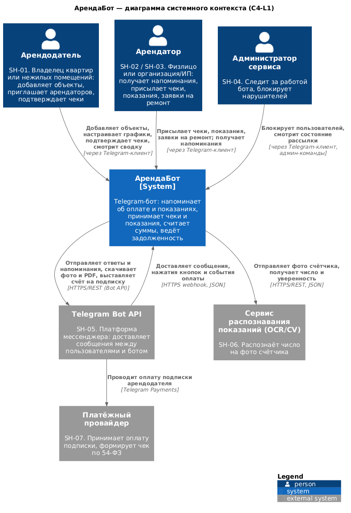
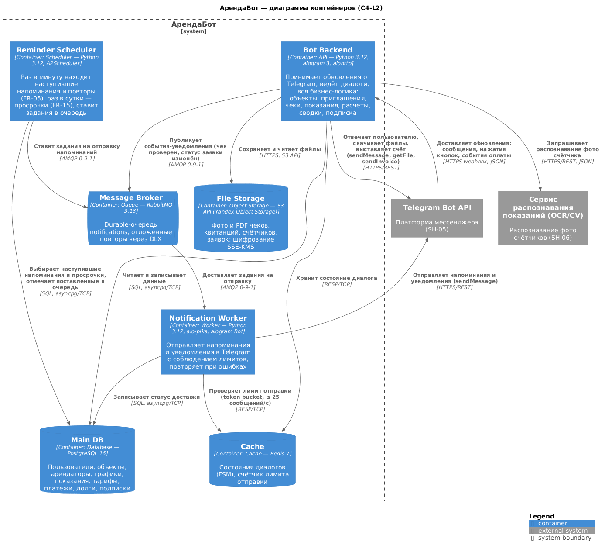
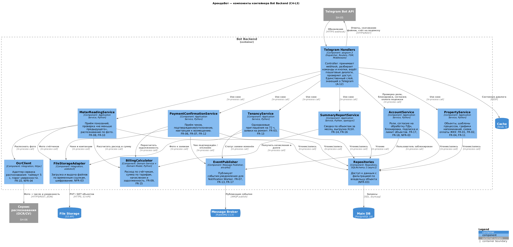

# Лабораторная работа №2. C4 model для проектирования архитектуры программной системы

## Титульный блок

| Поле | Значение |
|---|---|
| **Студент** | Мильто Семён Евгеньевич |
| **Группа** | РИС-23-1 |
| **Вариант** | Тема ВКР — «Разработка сервиса для управления взаимодействием арендодателя и арендаторов» (Telegram-бот «АрендаБот») |
| **Ссылка на ЛР №1** | [LAB_1_REPORT.md](../../Lab%20Work%20№1/docs/LAB_1_REPORT.md) |
| **Репозиторий** | <https://github.com/sunr1zy/software-architecture-labs> |
| **Инструмент диаграмм** | C4-PlantUML (исходники — `docs/c4/*.puml`) |

**Тема:** Использование нотации C4 model для проектирования архитектуры программной системы.

**Цель:** Получить опыт использования графической нотации для фиксации архитектурных решений.

---

## Краткое описание системы

«АрендаБот» — Telegram-бот для арендодателей жилых и нежилых помещений и их арендаторов: бот сам напоминает об оплате аренды, передаче показаний и оплате квитанций, принимает чеки и показания (в том числе распознаёт их по фото), считает суммы по тарифам и показывает владельцу, кто оплатил, а кто должен. Система та же, что в [ЛР №1](../../Lab%20Work%20№1/docs/LAB_1_REPORT.md).

**Ключевые NFR из ЛР №1, влияющие на архитектуру:** NFR-01 (надёжность напоминаний), NFR-02 (производительность и пиковая рассылка при лимитах Bot API), NFR-03 (безопасность ПДн и документов, 152-ФЗ).

---

## Оглавление

1. [Диаграмма системного контекста](#1-диаграмма-системного-контекста)
2. [Диаграмма контейнеров](#2-диаграмма-контейнеров)
3. [Диаграмма компонентов](#3-диаграмма-компонентов-контейнер-bot-backend)

---

## 1. Диаграмма системного контекста

На диаграмме — проектируемая система «АрендаБот», три актора из ЛР №1 (арендодатель, арендатор, администратор) и три внешние системы: Telegram Bot API, сервис распознавания показаний и платёжный провайдер. Физически пользователи работают с ботом через Telegram-клиент, поэтому их связи с системой подписаны «через Telegram-клиент», а сам обмен данными идёт через Telegram Bot API. Управляющие и ресурсоснабжающие организации (SH-08) на диаграмму не вынесены: интеграции с ними нет (A-06, FR-20 — Won't).

### Диаграмма

### Описание элементов

| Элемент | Тип | Назначение |
|---|---|---|
| Арендодатель (SH-01) | Person | Добавляет объекты, настраивает графики и тарифы, приглашает арендаторов, подтверждает чеки, смотрит сводку и долги |
| Арендатор (SH-02 / SH-03) | Person | Получает напоминания, присылает чеки, показания счётчиков, заявки на ремонт. Физлица и организации — один актор, различаются только шаблоном процесса (FR-02) |
| Администратор сервиса (SH-04) | Person | Блокирует нарушителей (FR-17), следит за работой рассылки |
| АрендаБот | System | Проектируемая система: напоминания, приём чеков и показаний, расчёт сумм, учёт задолженности |
| Telegram Bot API (SH-05) | System (внешняя) | Единственный канал взаимодействия с пользователями; ограничивает скорость отправки (~30 сообщений/с) |
| Сервис распознавания показаний (SH-06) | System (внешняя) | Распознаёт число на фото счётчика и возвращает уверенность (FR-10) |
| Платёжный провайдер (SH-07) | System (внешняя) | Проводит оплату подписки арендодателя через Telegram Payments, формирует чек по 54-ФЗ (FR-18) |

### Внешние интеграции

| Внешняя система | Протокол | Назначение |
|---|---|---|
| Telegram Bot API → АрендаБот | HTTPS webhook, JSON | Доставка сообщений, нажатий кнопок и событий оплаты (`pre_checkout_query`, `successful_payment`) |
| АрендаБот → Telegram Bot API | HTTPS/REST | Отправка ответов и напоминаний (`sendMessage`), скачивание фото и PDF (`getFile`), выставление счёта на подписку (`sendInvoice`) |
| АрендаБот → Сервис распознавания | HTTPS/REST, JSON | Отправка фото счётчика, получение числа и уверенности распознавания |
| Telegram → Платёжный провайдер | Telegram Payments | Проведение платежа за подписку. Бот напрямую с провайдером не взаимодействует: счёт выставляется и статус платежа приходит через Bot API |

---

## 2. Диаграмма контейнеров

Система состоит из трёх отдельно развёртываемых процессов (Bot Backend, Reminder Scheduler, Notification Worker) и четырёх хранилищ (PostgreSQL, Redis, RabbitMQ, объектное хранилище S3). Синхронные действия пользователя обрабатывает Bot Backend. Плановые напоминания и уведомления асинхронно идут через очередь RabbitMQ (AMQP) в Notification Worker, а он отправляет их в Telegram с соблюдением лимитов. Акторы на этом уровне не показаны, внешние системы — только те, с которыми контейнеры обмениваются данными напрямую.

### Диаграмма

### Описание контейнеров

| Контейнер | Тип | Технология | Назначение | Какие FR покрывает |
|---|---|---|---|---|
| Bot Backend | Container: API | Python 3.12, aiogram 3, aiohttp | Принимает обновления от Telegram по webhook, ведёт диалоги, содержит бизнес-логику | FR-01…FR-04, FR-06…FR-14, FR-16…FR-18 |
| Reminder Scheduler | Container: Scheduler | Python 3.12, APScheduler | Раз в минуту выбирает из БД наступившие напоминания и повторы, раз в сутки — просрочки. Ставит задания в очередь. Состояние хранится только в БД, поэтому после перезапуска пропущенные задания догоняются | FR-04 (исполнение графика), FR-05, FR-15 |
| Notification Worker | Container: Worker | Python 3.12, aio-pika, aiogram Bot | Читает задания из очереди и отправляет сообщения в Telegram с ограничением ≤ 25 сообщений/с. При ошибке повторяет через отложенную очередь, статус доставки пишет в БД. Масштабируется горизонтально | FR-05, FR-07, FR-13, FR-15, FR-17 (доставка уведомлений) |
| Message Broker | Container: Queue | RabbitMQ 3.13 | Durable-очередь `notifications`, отложенные повторы через dead-letter exchange | — |
| Main DB | Container: Database | PostgreSQL 16 | Пользователи, объекты, арендаторы, графики, показания, тарифы, платежи, долги, подписки | — |
| Cache | Container: Cache | Redis 7 | Состояния пошаговых диалогов (aiogram FSM), счётчик лимита отправки (token bucket) | — |
| File Storage | Container: Object Storage | S3 API (Yandex Object Storage, РФ) | Фото и PDF чеков, квитанций, счётчиков, заявок; шифрование на стороне сервера (SSE-KMS) | FR-06, FR-08, FR-12, FR-13 (хранение файлов) |

### Выбор архитектурного стиля — сравнение

Выбрана **сервисная архитектура (service-based)** с элементами **событийно-ориентированной** для рассылки: один основной сервис с бизнес-логикой, отдельные планировщик и воркер отправки, общая БД и асинхронная очередь между ними. Простой **многоуровневый монолит** отклонён. В одном процессе пиковая рассылка 1-го числа (10 000 сообщений) конкурировала бы с ответами пользователям и нарушала NFR-02 (p95 ≤ 1,5 с), а перезапуск процесса терял бы запланированные отправки (NFR-01). **Микросервисы** отклонены как избыточные для масштаба до 10 000 объектов (A-02) и одного разработчика: отдельные БД на сервис и распределённые транзакции между объектами, платежами и показаниями дали бы сложность без выигрыша. Выбранный стиль обеспечивает: **надёжность** (NFR-01) — durable-очередь, повторы через DLX, состояние напоминаний в БД; **производительность и масштабируемость** (NFR-02) — воркер отправки масштабируется отдельно и держит лимит Bot API, не тормозя бота; **безопасность** (NFR-03) — одна БД и одно шифруемое хранилище в РФ, доступ к данным только через Bot Backend.

---

## 3. Диаграмма компонентов (контейнер `Bot Backend`)

Для детализации выбран Bot Backend: в нём сосредоточена почти вся бизнес-логика (16 из 18 реализуемых FR), а остальные контейнеры выполняют узкие технические задачи. Внутри — классическое разбиение: слой Telegram-обработчиков (controllers), прикладные сервисы по сценариям, доменный сервис расчётов, репозитории и адаптеры к внешним системам. Только слой обработчиков знает о Telegram, остальное от него не зависит (A-12).

### Диаграмма

### Описание компонентов

| Компонент | Роль | Технология | Покрываемые FR |
|---|---|---|---|
| Telegram Handlers | Controller / API Layer | aiogram 3 Dispatcher, Routers, FSM, Middleware | Точка входа для всех FR; NFR-05 (диалоги на кнопках) |
| PropertyService | Application Service | Python | FR-01, FR-02, FR-04, FR-11 |
| TenancyService | Application Service | Python | FR-03, FR-13 |
| PaymentConfirmationService | Application Service | Python | FR-06, FR-07, FR-12 |
| MeterReadingService | Application Service | Python | FR-08, FR-10 |
| SummaryReportService | Application Service | Python, openpyxl | FR-14, FR-16 |
| AccountService | Application Service | Python | FR-17, FR-18; согласие на обработку ПДн (NFR-03) |
| BillingCalculator | Domain Service / Domain Model | Python (без внешних зависимостей) | FR-09, FR-15 |
| Repositories | Repository | SQLAlchemy 2 (async), asyncpg | — (фильтрация данных по владельцу, NFR-03) |
| OcrClient | Integration | httpx | FR-10; таймаут и порог уверенности — NFR-04 |
| FileStorageAdapter | Integration | aioboto3 (S3 API) | FR-06, FR-12, FR-13; шифрование и временные ссылки — NFR-03 |
| EventPublisher | Events / Message Publisher | aio-pika (AMQP) | FR-07, FR-13, FR-17 (события для уведомлений) |

**Механизмы связей:** между компонентами внутри контейнера — `in-process call`; Repositories → PostgreSQL — SQL (asyncpg); FileStorageAdapter → S3 — HTTPS (S3 API); OcrClient → сервис распознавания — HTTPS/REST; EventPublisher → RabbitMQ — AMQP publish; Telegram Handlers ↔ Telegram — HTTPS webhook / REST.

---

## Чек-лист самопроверки

- [x] Уровни C4: Context → Containers → Components
- [x] Context: одна проектируемая система, все акторы ЛР №1 и все внешние системы с интеграцией
- [x] Containers: 3 отдельно развёртываемых процесса, сетевое взаимодействие AMQP между ними
- [x] Containers: тип и технология в подписи каждого контейнера
- [x] Обоснование выбора архитектурного стиля
- [x] Components: у ключевых компонентов указаны FR из ЛР №1
- [x] PNG встроены в отчёт
- [x] Нет смешения уровней: технологий нет на контексте, акторов нет на контейнерах
